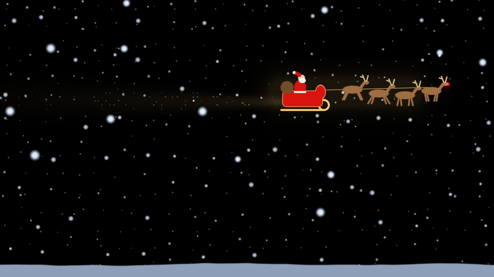
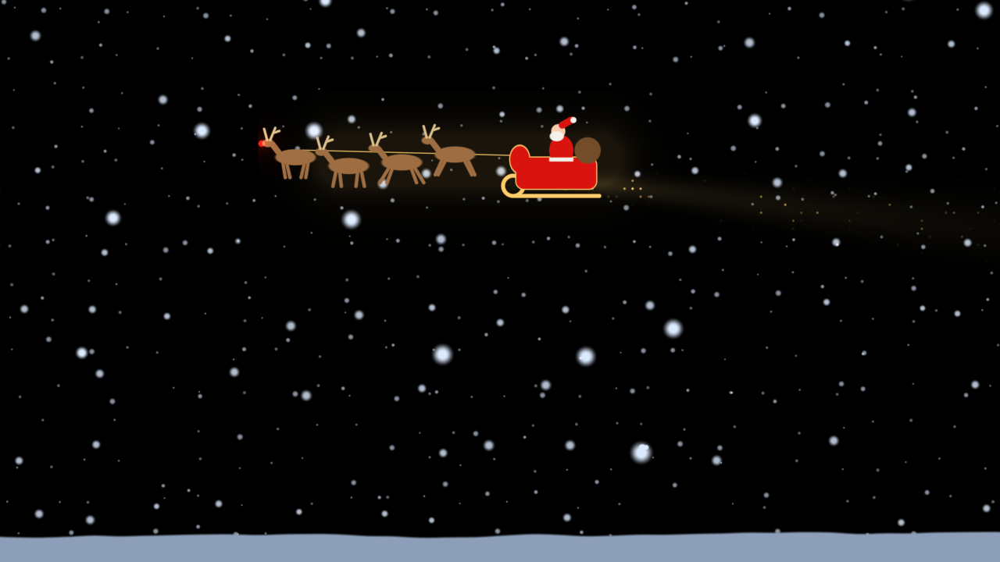
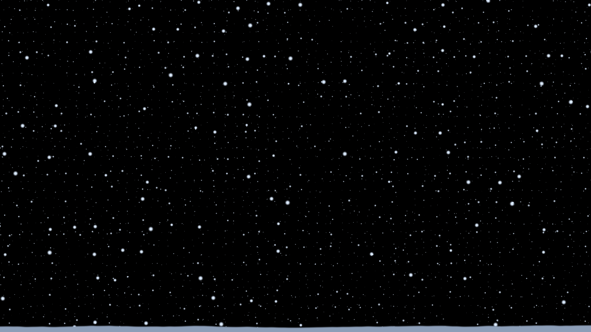

# Christmas scene: handoff to the haunted windows project

A working prototype of **snow that gusts when someone walks past** and
**Santa's sleigh flying across both projectors**, built in demoneye on
2026-10-10 and parked on the `christmas/snow-sleigh` branch. It's to be
rebuilt in the Godot haunted windows project, which has a real GPU. This note
is the design and the contract to carry over; `christmas.py` on that branch is
the reference implementation.

Run the reference (from demoneye, on the branch):

```bash
./venv/bin/python demoneye.py --role brain --solo --windowed --eye christmas --stats
./venv/bin/python track_test.py sweep          # a fake passer-by, in a second terminal
CHRISTMAS_SIDE=left ./venv/bin/python demoneye.py --role brain --solo --windowed --eye christmas
```

| | |
|---|---|
|  |  |
| Left projector: the sleigh heading for the right one | Flying the other way, the team still leads |



## The idea in one line

The house **reacts** to people walking past rather than **watching** them:
that's what keeps it cozy instead of creepy (the Halloween eyes lock on; this
never does).

## The scene

- **One wide world, two windows onto it.** World units: 1 = one screen
  height. Each projector shows a 16:9 window; their centres are
  `SEPARATION = 3.0` screen heights apart, so the world spans
  `±SPAN = ±(SEPARATION/2 + ASPECT/2) ≈ ±2.39`. The gap between the projectors
  is part of the world: the sleigh flies through it unseen. **Measure the real
  distance between the two projected pictures and set SEPARATION from it.**
- **Snow:** 4 parallax layers (near = big, fast, bright; far = small, slow,
  dim), each flake wobbling side to side, a breeze that wanders
  (`0.18·sin(0.11t) + 0.08·sin(0.37t + 1.3)`), and a low snowbank along the
  bottom of each picture.
- **A passer-by:** pushes the wind in the direction they walk
  (`wind = breeze + 1.2 × their sideways speed`, clamped to ±1, eased) and
  makes the flakes near them eddy in small loops. Ramps in over ~0.4 s and dies
  away over a few seconds after they leave. Lesson from the prototype: *move
  the flakes*, don't warp the space; rotating the sample space smeared the
  flakes into streaks. With real particles in Godot, an attractor or vortex
  force field around the person is the natural fit.
- **The sleigh:** Santa with his sack, four galloping reindeer, Rudolph's
  glowing nose, gold reins, a soft gold halo, and a sparkle trail that fades
  over ~1.8 world units and drifts down behind it. It flies at a gentle arc
  (`altitude + 0.04·sin(1.7x)`), with the altitude random in 0.08–0.28 above the
  centre line, at `0.75` world units/s. It starts and finishes `0.8` beyond the
  outer edges, so a full crossing takes about 8.5 s.

## When things happen (the director)

One machine decides (the "brain"), so both windows agree.

| Event | Rule |
|---|---|
| First flight | 4 s after start (handy for previews; maybe longer for the show) |
| Someone arrives (a target appears) | launch the sleigh if none is flying and 20 s have passed since the last one finished. It flies in their direction (from the far side toward them), or a random direction if they're dead centre |
| Nobody around | a flight every 60–150 s (random) |
| Someone walking | wind pushed their way; gust centred on them, following them |
| They leave (target expires or `clear`) | gust fades; wind returns to the breeze |

In the reference these are the constants at the top of `christmas.py`
(`SLEIGH_SPEED`, `SLEIGH_COOLDOWN`, `IDLE_FLIGHT`, `FIRST_FLIGHT`, …) and the
rules are in `ChristmasDirector.update()`. `tests/test_christmas.py` pins the
behaviour down.

## The MQTT contract (unchanged: reuse the existing bridge and schedule)

Broker as in demoneye's `config.ini`. Nothing on the Home Assistant side needs
to change: the radar bridge, the Node-RED schedule, `switch.halloween_eyes_show`
and the Govee scenes all keep working.

| Topic | Payload | Notes |
|---|---|---|
| `halloween/eyes/command` | `on` / `off`, retained, QoS 1 | Also accepts `1/0`, `true/false`, `play/stop`… or `{"state": "ON"}`. Start the show on `on`, go black on `off`. It's retained, so read it on connect. |
| `halloween/eyes/target` | `{"x": -0.42, "y": 0.0, "hold": 2.0}` or `clear` | `x`: −1 = screen-left .. +1 = screen-right, as the audience sees the picture. In the reference, world x = `x × SPAN`. `hold`: seconds to keep it without an update. The bridge re-sends every 0.75 s while someone is there and sends `clear` when they go (or when the show turns off or HA drops). |
| `halloween/eyes/state` | demoneye's own brain→follower stream | Don't publish here: it's the eyes' topic. Use your own topic if the Godot side needs a brain/follower split, e.g. `halloween/windows/state`. |
| `halloween/eyes/status/<node>/…` | HA discovery status | Optional. If Godot should show up in HA, publish its own node the same way (see demoneye's `ha_status.py`). |

Only **one** bridge may run (they share an MQTT client ID). Today it runs on
`pi-eye-right`.

## Lessons from demoneye worth keeping

- **Validate MQTT numbers.** JSON accepts `NaN`/`Infinity`; reject non-finite
  `x`/`y`, and fall back on a non-finite or negative `hold`. Cap `hold` (30 s in
  demoneye).
- **Monotonic clocks** for every timeout and deadline. The Pis have no RTC and
  NTP steps the clock after boot.
- **Reconnect in the background** and keep retrying: the broker may come up
  after the machine does.
- **Read targets once per frame.** The MQTT callback runs on another thread;
  hand the target over as one atomic value (demoneye stores an `(x, y,
  deadline)` tuple).
- **Go dark on silence.** A follower that stops hearing the brain should cut to
  black rather than freeze on its last frame.

## Open questions for the Godot version

- The real `SEPARATION` between the two pictures on the house.
- Is the sleigh taking 8.5 s to cross right? Should flights be more frequent
  while people are around?
- Cozy windows (fireplace, tree, a cat on the sill, snow outside) as the
  everyday scene, with the snow and sleigh layered over or between them?
